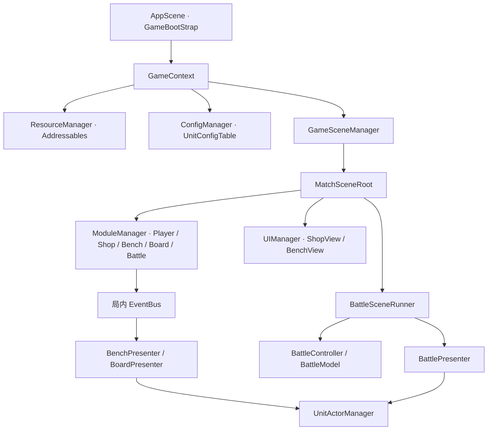
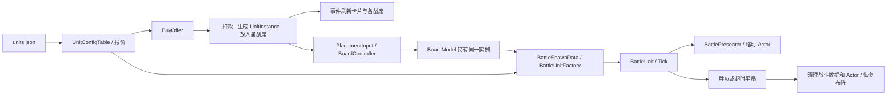

# GridForge Showcase

一个可重复演示的 Unity 自走棋小工程。玩家用 10 枚金币购买棋子，把备战席中的实体拖到六边形棋盘上，再观察同一份配置如何生成战斗单位。演示保留了原工程的模块注册、数据模型、事件分发、资源加载和战斗循环。


## 运行与操作

1. 在 Unity Hub 中添加本目录，用 **2022.3.55f1c1** 打开。首次导入需要能从包注册表或本机包缓存取得锁定版本。
2. 打开 `Assets/Scenes/AppScene.unity`，进入 Play，点 **Enter match**。MatchScene 由入口以 Additive 方式加载。
3. 首屏第一张固定展示已有完整模型和动画的**吉伊**，售价 1 金。点商店卡片购买，或点 **Refresh | Free** 重新抽取五个报价。金币、已售状态、备战席和场景胶囊随购买更新。备战席有七个位置。
4. 用鼠标左键抓取**场景中的胶囊**，拖到己方四行之一的空格，松手落子。准备阶段可调整站位，Esc 取消拖动。将棋子拖入商店出售区可回收。
5. 点右上角 **Start battle** 或按 **B**。蓝方使用当前上阵阵容，红方使用五个固定配置。屏幕中央显示**胜利、失败或平局**。按任意键返回准备阶段，保留原阵容并可再次开战。

## 核心架构



## 从商店到战斗



战斗按帧读取数据，先收集移动和攻击意图，再统一应用。生命值和胜负由控制器计算，胶囊和头顶名称由 Presenter 与 Actor 更新。准备棋子用实例 ID 标识，本场战斗使用独立 BattleId，并保留己方来源实例 ID。同一种棋子可同时购买和上阵多枚。

技术栈为 C#、UGUI、TextMeshPro、Input System、Addressables 与 JSON。局内使用同步事件刷新多个观察者，购买和拖放使用直接调用返回结果。分阶段的战斗循环、资源所有权和拆分代价见[架构说明](docs/architecture.md)，面试演示提纲见[面试说明](docs/interview-notes.md)。

## 验证与边界

编辑器 Play Mode 已验证从菜单进入、购买与扣款、相机拾取和落子、连续两次开战与结算、恢复准备、出售及销毁。测试验证六种中文名称、镜头转动、战斗前后资源与监听恢复。复跑时关闭同一项目的编辑器，从终端运行下列命令，Unity 和项目路径按本机位置填写。

```text
Unity.exe -batchmode -projectPath "<Showcase 绝对路径>" -executeMethod ShowcaseSmoke.Run -logFile "<日志绝对路径>"
```

无技能、Buff、联网、经济回合或多轮进度保存。战斗移动使用连续空间，单位可能聚到一起，密集时头顶文字也可能互相遮挡。编辑器检查使用按钮回调和屏幕坐标拖拽处理函数。独立 Player、实体鼠标操作和不同屏幕比例仍需验收。后续可先补齐这些验证，再按演示需要扩展敌方阵容。提取范围和发布前事项见[交付记录](docs/AI_HANDOFF.md)。

吉伊的 Prefab、六段动画、资源地址与验证记录见[角色资源清单](docs/CharacterResources/Chiikawa_RESOURCE_MANIFEST.md)。其余五种棋子沿用胶囊表现。
