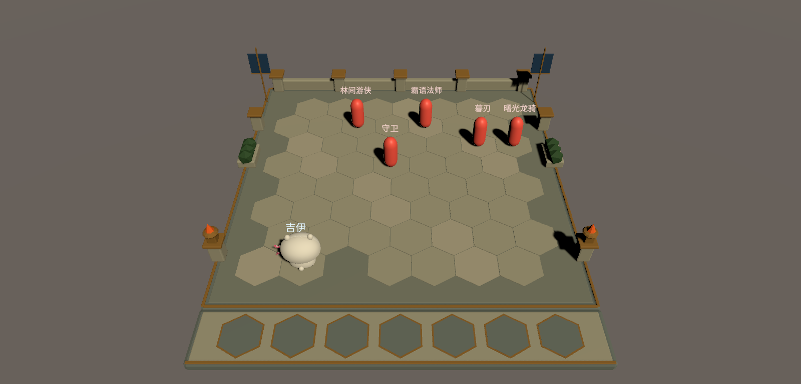
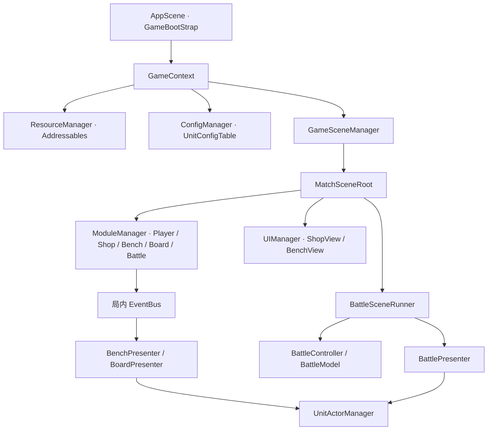
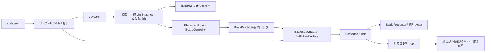

# GridForge · 自走棋玩法展示

GridForge 是用 Unity 和 C# 开发的自走棋原型。玩家从 10 枚金币起步，购买棋子、拖拽布阵，然后让双方自动交战。战斗结束后可以带着原阵容返回商店，调整站位再战。

项目展示了同一份棋子配置如何贯穿商店、备战席、棋盘和战斗。战斗控制器负责寻敌、移动、攻击与胜负判定，场景中的角色根据战斗数据更新位置、动画和头顶名称。



## 运行与操作

1. 安装 Git LFS，克隆仓库后在根目录运行 `git lfs pull`，取得模型与动画。在 Unity Hub 中添加本目录，用 **2022.3.55f1c1** 打开。首次导入需要能从包注册表或本机包缓存取得锁定版本。
2. 打开 `Assets/Scenes/AppScene.unity`，进入播放模式，点击 **Enter match**（进入对局）。启动场景会叠加加载对局场景 `MatchScene`。
3. 首张商品卡固定为**吉伊**，售价 1 枚金币。点击卡片后，商店扣款并标记已售，棋子出现在备战席的空位。备战席共七个位置；点击 **Refresh | Free**（免费刷新）可重抽五张商品卡。
4. 用鼠标左键抓取**备战席上的棋子实体**，拖到己方四行之一的空格，松手落子。准备阶段可调整站位，Esc 取消拖动。将棋子拖入商店出售区可回收。
5. 点右上角 **Start battle**（开始战斗）或按 **B**。蓝方使用当前上阵阵容，红方使用五个固定配置。屏幕中央显示**胜利、失败或平局**。按任意键返回准备阶段，保留原阵容并可再次开战。

## 核心架构



## 从商店到战斗



战斗按帧读取数据，先收集移动和攻击意图，再统一应用。生命值和胜负由控制器计算，胶囊和头顶名称由 Presenter 与 Actor 更新。准备棋子用实例 ID 标识，本场战斗使用独立 BattleId，并保留己方来源实例 ID。同一种棋子可同时购买和上阵多枚。

技术栈为 C#、UGUI、TextMeshPro、Input System、Addressables 与 JSON。局内使用同步事件刷新多个观察者，购买和拖放使用直接调用返回结果。分阶段的战斗循环、资源所有权和拆分代价见[架构说明](docs/architecture.md)，面试演示提纲见[面试说明](docs/interview-notes.md)。

## 验证与边界

Unity 编辑器播放模式已验证购买扣款、拾取落子、连续开战、结算返场和出售清理。结算回归覆盖两场自然失败，以及测试构造的胜利和平局。测试也检查六种棋子的中文字形、名称朝向，以及返场后的资源引用和事件订阅。复跑时关闭同一项目的编辑器，从终端运行下列命令，Unity 和项目路径按本机位置填写。

```text
Unity.exe -batchmode -projectPath "<Showcase 绝对路径>" -executeMethod ShowcaseSmoke.Run -logFile "<日志绝对路径>"
```

无技能、Buff、联网、经济回合或多轮进度保存。战斗移动使用连续空间，单位可能聚到一起，密集时头顶文字也可能互相遮挡。编辑器检查使用按钮回调和屏幕坐标拖拽处理函数。独立客户端构建、真实鼠标操作和不同屏幕比例仍需验收。后续可先补齐这些验证，再按演示需要扩展敌方阵容。提取范围和发布前事项见[交付记录](docs/AI_HANDOFF.md)。

吉伊的 Prefab、六段动画、资源地址与验证记录见[角色资源清单](docs/CharacterResources/Chiikawa_RESOURCE_MANIFEST.md)。其余五种棋子沿用胶囊表现。
